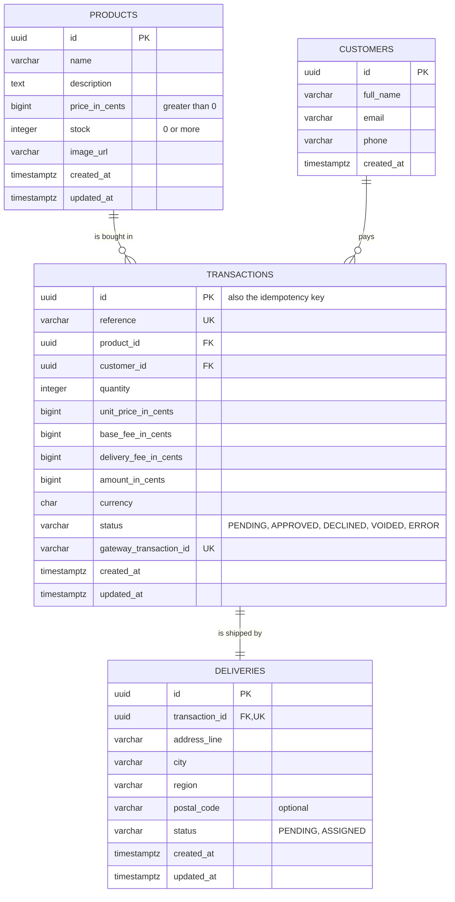

# Product Checkout

[](https://github.com/jhoan636/checkout-app/actions/workflows/ci.yml)

A store that sells one product with a credit card checkout. The customer sees the product and its stock, enters card and delivery data, reviews a payment summary, pays through an external payment gateway (sandbox) and gets the final status. Stock is updated once the payment is resolved.

> Work in progress. The API is complete. The web app has the first two screens; the status of every part is listed in [Progress](#progress).

## Repository layout

| Folder | Content |
|---|---|
| `api/` | REST API in NestJS + TypeScript, hexagonal architecture (ports and adapters) and Railway Oriented Programming |
| `web/` | SPA in React + TypeScript + Redux Toolkit, mobile first |
| `infra/` | AWS infrastructure as code (CDK), added with the deployment |

Each app is independent: its own `package.json`, tests and deployment.

## Checkout flow

1. **Product page**: photo, description, price, units in stock and the payment button.
2. **Credit card and delivery info**: a modal with card and delivery fields.
3. **Payment summary**: product amount, base fee and delivery fee, with the payment button.
4. **Final status**: result of the payment.
5. **Back to the product page** with the updated stock.

The store sells a single product, seeded by a database migration. Each purchase is for that product and one or more of its units; there is no cart.

## Progress

| Part | Status |
|---|---|
| API: products, stock, transactions, customers, deliveries, webhook | Done |
| API: Swagger docs, security headers, rate limit, CORS | Done |
| Web: product page | Done |
| Web: card and delivery form | Done |
| Web: card tokenization and payment summary | Done |
| Web: payment and final status | Done |
| Web: progress recovery after a refresh | Done |
| AWS deployment | Pending |

## Deployed app

_TBD_

## API documentation

Swagger UI is served by the API at `/docs` and the OpenAPI document at `/docs-json` (locally: http://localhost:3000/docs). The public URL is added with the deployment.

| Method | Path | Purpose |
|---|---|---|
| `GET` | `/health` | Liveness check |
| `GET` | `/products` | The product of the store with its current stock |
| `GET` | `/products/:id` | One product |
| `GET` | `/products/:id/payment-summary?quantity=` | Amounts to pay: subtotal, base fee, delivery fee and total |
| `POST` | `/transactions` | Creates the transaction as `PENDING` and asks the gateway to charge it. Requires an `Idempotency-Key` header (UUID) |
| `GET` | `/transactions/:id` | Current status; asks the gateway again while it is `PENDING` |
| `GET` | `/transactions/:id/customer` | Customer of the transaction, with email and phone masked |
| `GET` | `/transactions/:id/delivery` | Delivery of the transaction |
| `POST` | `/webhooks/payment-gateway` | Payment result sent by the gateway; rejected with `401` if its signature is wrong |

There is no endpoint to create products: the product is seeded by a database migration.

## Architecture

The API follows hexagonal architecture. Dependencies point inwards only.

| Layer | Folder | Content |
|---|---|---|
| Domain | `api/src/domain` | Business rules in plain TypeScript: money, quantities, transaction status, payment summary |
| Application | `api/src/application` | Use cases and the ports (interfaces) they need: repositories, payment gateway, clock, id generator |
| Infrastructure | `api/src/infrastructure` | Adapters: HTTP controllers, PostgreSQL repositories (TypeORM), payment gateway client, configuration |

Use cases never throw for an expected failure. They return a `Result<T, E>` and are chained with `map` and `andThen` (Railway Oriented Programming), so every error path is visible in the types. Controllers translate each error into an HTTP status in one place.

## Business rules

- Money is always an integer amount of cents; there are no decimals anywhere.
- The amount to charge is computed by the API from the stored price and the fees. The browser never sends an amount.
- A transaction is stored as `PENDING` before the gateway is called, and only moves from `PENDING` to `APPROVED`, `DECLINED`, `VOIDED` or `ERROR`.
- When a payment is approved, the status change, the stock decrement and the delivery assignment happen in a single database transaction.
- The `Idempotency-Key` header is the transaction id: sending the same request twice returns the same transaction and never charges twice.
- The gateway usually answers `PENDING` first. The final status arrives through the webhook or by asking `GET /transactions/:id` again.

## Data model



The schema only changes through SQL migrations, which run when the API starts. Card data is not part of the model: it is never stored.

## Card validation in the browser

The form helps the customer type the card correctly before anything is sent. The payment gateway remains the one that really validates the card.

| Check | Rule |
|---|---|
| Brand | VISA starts with `4`. MasterCard starts with `51`–`55` or `2221`–`2720`. Any other brand is rejected |
| Length | VISA: 13, 16 or 19 digits. MasterCard: 16 digits |
| Check digit | Luhn algorithm, which catches a mistyped digit |
| Expiry date | `MM/YY`, valid until the end of that month |
| Security code | 3 digits |

The rules live in `web/src/lib/card.ts`.

### Cards that work in the sandbox

The gateway's test environment only accepts two card numbers. Any other number, MasterCard included, is refused when the card is tokenized, and the form answers "The card was not accepted".

| Card number | Result of the payment |
|---|---|
| `4242 4242 4242 4242` | Approved |
| `4111 1111 1111 1111` | Declined |

Use any future expiry date, any 3-digit security code and any name of 5 characters or more.

## Recovering progress after a refresh

The checkout keeps a small snapshot in `localStorage`, so a refresh does not send the customer back to the start.

| Refresh on | The app comes back to |
|---|---|
| Product page | The product, with the chosen units |
| Card and delivery form | The form, with the contact and delivery details; the card is typed again |
| Summary | The form, because the card token is never saved |
| Final status | The final status, asked to the API again |

- The snapshot holds the step, the product, the units, the contact and delivery details and the id of a payment already sent. It never holds the card, its token or anything the gateway answered.
- It expires after 30 minutes and is removed when the purchase ends.
- Storage can be edited by hand, so every field is validated when it is read; anything unexpected discards the whole snapshot.
- If the API does not know the saved payment, the request never arrived: the app says the card was not charged and lets the customer start again.

The rules live in `web/src/store/persistence.ts`.

## Test coverage

Every pull request runs lint, build and tests for `api/` and `web/` in GitHub Actions. The run fails if coverage drops below 80% in statements, branches, functions or lines.

Results on 2026-11-15:

| App | Tests | Statements | Branches | Functions | Lines |
|---|---|---|---|---|---|
| `api/` (unit) | 327 | 99.15% | 92.18% | 98.34% | 99.15% |
| `api/` (end-to-end, real PostgreSQL) | 22 | – | – | – | – |
| `web/` (unit) | 293 | 100% | 99.07% | 100% | 100% |

To reproduce them, run `npm run test:cov` inside `api/` and inside `web/`.

## Running locally

Requirements: Node 22 and Docker.

### API

```bash
cd api
npm install
cp .env.example .env   # then set DB_PASSWORD and the gateway sandbox keys
npm run db:up          # PostgreSQL in Docker, on port 5433
npm run start:dev      # http://localhost:3000/health
```

| Command | What it does |
|---|---|
| `npm test` | Unit tests |
| `npm run test:cov` | Unit tests with coverage (fails under 80%) |
| `npm run test:e2e` | End-to-end tests, needs the database running |
| `npm run db:down` | Stops the database |

### Web

```bash
cd web
npm install
cp .env.example .env.local   # then set the gateway sandbox URL and PUBLIC key
npm run dev                  # http://localhost:5173
```

| Command | What it does |
|---|---|
| `npm test` | Unit tests |
| `npm run test:cov` | Unit tests with coverage (fails under 80%) |
| `npm run lint` | Static checks |
| `npm run build` | Type check and production build |

The API must be running, and its `CORS_ORIGINS` must include the web origin (the default already allows `http://localhost:5173`).

## Security

- The card number, expiry date and security code stay in the memory of the form while it is open. They are never written to the Redux store, to `localStorage` or to a log; the store keeps only the brand and the last four digits.
- The API has no field for card data: it receives a card token only. Tokenization happens in the browser, directly with the gateway and its public key.
- Private keys and secrets live only in environment variables, never in the repository.
- Webhook events are accepted only if their checksum matches, compared in constant time.
- HTTP security headers (helmet) with a strict Content Security Policy, `Cache-Control: no-store`, a CORS allow-list and a rate limit per client.
- Request bodies are validated against a whitelist: unknown fields are rejected.
- Request logs contain no bodies, headers or identifiers. Customer email and phone are returned masked.

## Known limitations

- A payment approved when the last unit was sold in the meantime stays `APPROVED` with its delivery unassigned; it needs a manual refund.
- A `PENDING` transaction that never received a gateway id is resolved only by the webhook.
- There is no login. Each purchase creates a new customer row.
- `npm audit` reports 3 moderate findings in a transitive dependency of TypeORM; the fix requires the next major version.

## Credits

- Structure of the checkout screens inspired by "A Checkout Flow" by Banu Elmas (Figma Community, CC BY 4.0). No screens or assets were copied.
- Colour palette (polar white, glacier blue, racing red) built on the 60/30/10 rule.
- Brand marks in the card form are simplified drawings used only to identify the card type.
