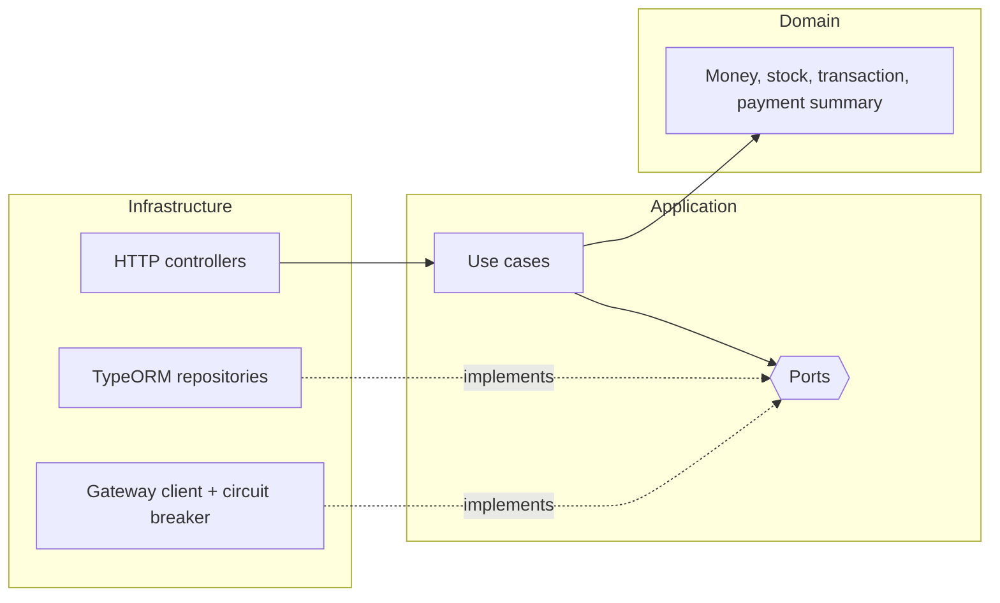
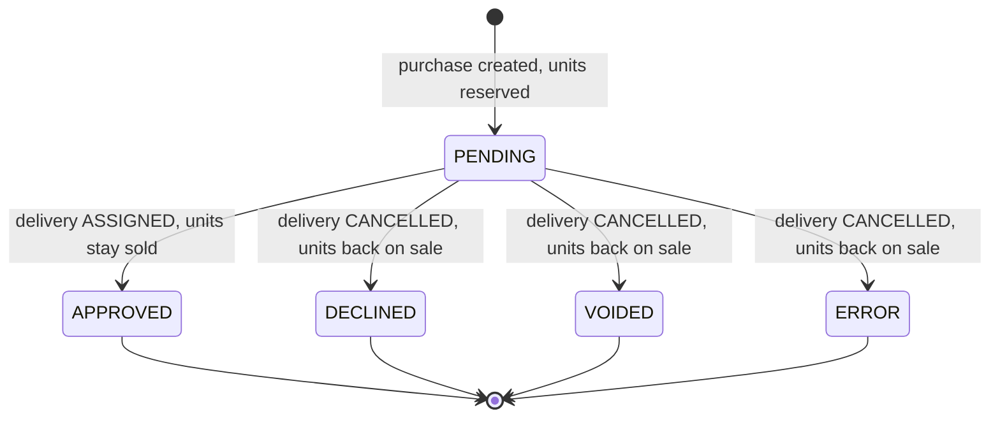
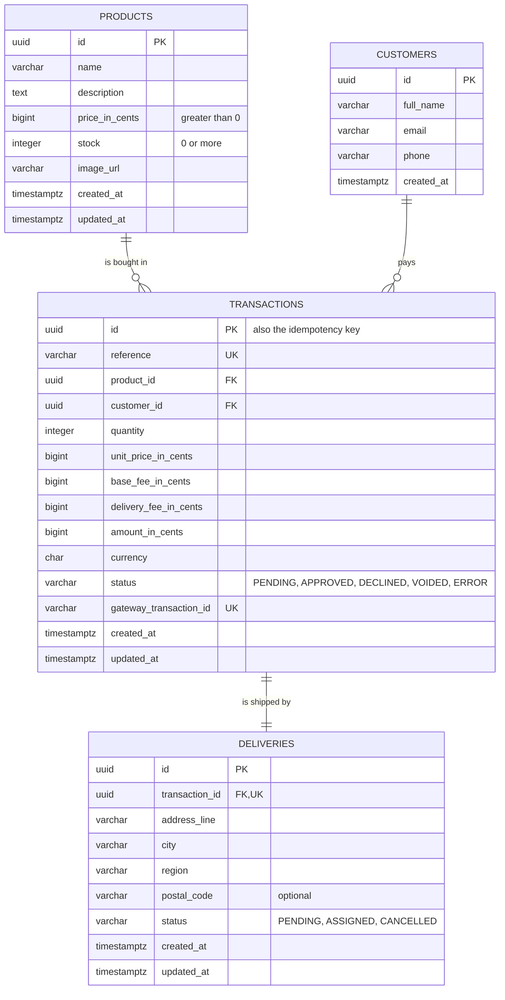
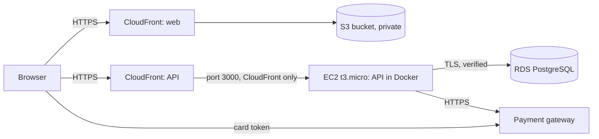

# Product Checkout

[](https://github.com/jhoan636/checkout-app/actions/workflows/ci.yml)

A store that sells one product with a credit card checkout: product page, card and delivery form, payment summary, final status, and back to the product with its stock updated. It is paid through the sandbox of an external payment gateway.

## For the evaluator

| | |
|---|---|
| **Live app** | https://d3k0ykcdsl3mak.cloudfront.net |
| **API and Swagger** | https://d3sdb497078jpk.cloudfront.net/docs ([OpenAPI document](https://d3sdb497078jpk.cloudfront.net/docs-json)) |
| **Repository** | https://github.com/jhoan636/checkout-app |
| **Coverage** | API 99.3% · Web 100% of lines, with Jest. See [Test coverage](#test-coverage) |

**Only these two cards work.** The sandbox of the gateway refuses any other number, MasterCard included, and the form then answers "The card was not accepted":

| Card number | Result |
|---|---|
| `4242 4242 4242 4242` | Approved |
| `4111 1111 1111 1111` | Declined |

Use any future expiry date, any 3-digit security code and a name of 5 characters or more. The sandbox can take from a few seconds to a few minutes to answer; meanwhile the app says the payment is still being confirmed.

## Contents

- [Where each requirement is met](#where-each-requirement-is-met)
- [Checkout flow](#checkout-flow)
- [Architecture](#architecture)
- [Business rules](#business-rules)
- [Data model](#data-model)
- [API](#api)
- [Test coverage](#test-coverage)
- [Deployment](#deployment)
- [Recovering progress after a refresh](#recovering-progress-after-a-refresh)
- [Card validation in the browser](#card-validation-in-the-browser)
- [Security](#security)
- [Running locally](#running-locally)
- [Use of AI](#use-of-ai)
- [Known limitations](#known-limitations)

More detail: [payment flow](docs/payment-flow.md) · [decisions and their reasons](docs/decisions.md).

## Where each requirement is met

In the order of the evaluation rubric.

| Points | Criterion | Where | Evidence |
|---|---|---|---|
| 5 | README | This file | [Data model](#data-model), [public Swagger](https://d3sdb497078jpk.cloudfront.net/docs), [coverage results](#test-coverage), [deployment links](#for-the-evaluator) |
| 5 | Fast images, nothing out of bounds | `web/src/components/ProductPhoto.tsx` | One 120 KB WebP with its real size declared, so the page does not jump. Layouts checked from an iPhone SE (375 px) to 1920 px |
| 20 | Checkout flow | `web/src/features` | [Checkout flow](#checkout-flow), [live app](https://d3k0ykcdsl3mak.cloudfront.net) |
| 20 | API | `api/src` | Stock, transactions, customers and deliveries: [API](#api), [Swagger](https://d3sdb497078jpk.cloudfront.net/docs) |
| 30 | More than 80% of coverage with Jest, front and back | `*.spec.ts`, `*.test.tsx`, `api/test` | [Test coverage](#test-coverage). Both apps run Jest; CI fails under 80% |
| 20 | Deployed in the cloud | `infra/` | [Deployment](#deployment) on AWS, as code |
| 5 bonus | OWASP, HTTPS and security headers | `api/src/infrastructure/http/configure-app.ts`, `infra/template.yml` | [Security](#security); A+ in Mozilla Observatory |
| 5 bonus | Responsive, different browsers | `web/src/styles`, one stylesheet per feature | Mobile first, with layouts for phone, tablet and desktop. Tested in Chrome and Edge |
| 10 bonus | CSS | `web/src/styles/tokens.css` | Plain CSS with grid and flexbox, no framework; colours, type sizes, radii and spacing come from tokens |
| 10 bonus | Clean code | `.github/workflows/ci.yml` | Lint and type checks on every pull request, one pull request per feature, Conventional Commits |
| 10 bonus | Hexagonal architecture | `api/src/domain`, `application`, `infrastructure` | [Architecture](#architecture) |
| 10 bonus | Railway Oriented Programming | `api/src/domain/shared/result.ts` | [Architecture](#architecture) |

Also required by the statement:

| Requirement | Where | Evidence |
|---|---|---|
| React SPA with Redux, following Flux | `web/src/store` | Redux Toolkit slices for the product, the checkout and the transaction; components only dispatch actions and read state |
| Recover the progress after a refresh | `web/src/store/persistence.ts` | [Recovering progress](#recovering-progress-after-a-refresh) |
| NestJS, with the business logic outside the controllers | `api/src/application/use-cases` | [Architecture](#architecture) |
| Database seeded, no endpoint to create products | `api/src/infrastructure/database/migrations` | The product is seeded by a migration that runs when the API starts |
| Sensitive data handled safely | `web/src/features/details`, `api/src/infrastructure/http` | The card never reaches the API or any storage: [Security](#security) |

## Checkout flow

1. **Product page**: photo, description, price, units in stock and the payment button.
2. **Credit card and delivery info**: a modal with card and delivery fields, with VISA and MasterCard detection.
3. **Payment summary**: product amount, base fee and delivery fee, with the payment button, in a backdrop.
4. **Final status**: result of the payment.
5. **Back to the product page** with the updated stock.

The store sells a single product; each purchase is for one or more of its units. There is no cart.

| Folder | Content |
|---|---|
| `api/` | REST API in NestJS + TypeScript |
| `web/` | SPA in React + TypeScript + Redux Toolkit, mobile first |
| `infra/` | AWS infrastructure as code (CloudFormation) and the scripts that deploy and remove it |
| `docs/` | The payment flow in detail and the reasons behind the decisions |

## Architecture

The API follows hexagonal architecture (ports and adapters). Dependencies point inwards only.

| Layer | Folder | Content |
|---|---|---|
| Domain | `api/src/domain` | Business rules in plain TypeScript: money, quantities, transaction status, payment summary |
| Application | `api/src/application` | Use cases and the ports (interfaces) they need: repositories, payment gateway, clock, id generator |
| Infrastructure | `api/src/infrastructure` | Adapters: HTTP controllers, PostgreSQL repositories (TypeORM), payment gateway client, configuration |



The domain imports nothing from NestJS, TypeORM or the gateway: it is plain TypeScript, tested without a database or a network. The use cases depend on ports (interfaces); the database and the gateway are adapters that can be replaced, which is how the tests run the use cases against in-memory fakes.

### Railway Oriented Programming

Use cases never throw for an expected failure. They return a `Result<T, E>`, and the steps that can fail are chained with `andThen`: each step runs only if the one before succeeded, and the first failure is the answer. Every error path is visible in the types. Controllers leave the railway with `match`: a success becomes the response and a failure becomes its HTTP status, in one place (`api/src/infrastructure/http/errors`).

```ts
// api/src/application/use-cases/create-transaction.use-case.ts
const order = andThen(
  andThen(reserveStock(product, command.quantity), () =>
    calculatePaymentSummary({ unitPriceInCents: product.priceInCents, quantity: command.quantity }, this.fees),
  ),
  (summary) => createPendingTransaction({ /* id, reference, amounts */ }),
);
```

## Business rules

- **Money is an integer amount of cents**, never a decimal. The amount to charge is computed by the API from the stored price and the fees; the browser never sends an amount.
- **The last unit cannot be sold twice.** The units leave the stock in the same database transaction that stores the `PENDING` purchase (`UPDATE … WHERE stock >= n`). A second buyer gets `409 INSUFFICIENT_STOCK` before any charge.
- **A retry never charges twice.** The `Idempotency-Key` header is the transaction id: sending the same request again returns the same transaction.
- **A purchase is settled once.** Status, delivery and stock change in a single database transaction, however many times the result arrives.
- **A lost answer is not a lost purchase.** It is stored as `PENDING` before the gateway is called, and resolved later by asking the gateway.



A final status never changes again. What happens on a timeout, with the gateway down or with a lost answer is in [docs/payment-flow.md](docs/payment-flow.md).

## Data model



The schema only changes through SQL migrations, which run when the API starts. Card data is not part of the model: it is never stored. Each purchase keeps its own customer row, because without a login a typed email proves nothing about who is buying ([why](docs/decisions.md#each-purchase-keeps-its-own-customer-row)).

## API

Swagger UI is served at `/docs` and the OpenAPI document at `/docs-json`.

| Method | Path | Purpose |
|---|---|---|
| `GET` | `/health` | Liveness check |
| `GET` | `/products` | The product of the store with its current stock |
| `GET` | `/products/:id` | One product |
| `GET` | `/products/:id/payment-summary?quantity=` | Amounts to pay: subtotal, base fee, delivery fee and total |
| `POST` | `/transactions` | Creates the transaction as `PENDING` and asks the gateway to charge it. Requires an `Idempotency-Key` header (UUID) |
| `GET` | `/transactions/:id` | Current status; asks the gateway again while it is `PENDING` |
| `GET` | `/transactions/:id/customer` | Customer of the transaction, with email and phone masked |
| `GET` | `/transactions/:id/delivery` | Delivery of the transaction |
| `POST` | `/webhooks/payment-gateway` | Payment result sent by the gateway; rejected with `401` if its signature is wrong |

Every error has the same shape, with a stable code in `error`:

```json
{ "statusCode": 409, "error": "INSUFFICIENT_STOCK", "message": "There are not enough units in stock." }
```

| Status | Codes |
|---|---|
| `400` | `VALIDATION_ERROR` (`message` is a list, one entry per problem), `INVALID_IDEMPOTENCY_KEY`, `BAD_REQUEST` |
| `401` | `UNAUTHORIZED` (webhook with a wrong signature) |
| `404` | `PRODUCT_NOT_FOUND`, `TRANSACTION_NOT_FOUND`, `NOT_FOUND` |
| `409` | `INSUFFICIENT_STOCK` |
| `413` | `PAYLOAD_TOO_LARGE` |
| `422` | `INVALID_QUANTITY`, `INVALID_AMOUNT` |
| `429` | `TOO_MANY_REQUESTS` |
| `500` | `INTERNAL_ERROR` (the message never reveals the cause) |

## Test coverage

Every pull request runs lint, build and tests for `api/` and `web/` in GitHub Actions. Both apps use Jest, and the run fails if coverage drops below 80% in statements, branches, functions or lines.

Results on 2026-11-16:

| App | Tests | Statements | Branches | Functions | Lines |
|---|---|---|---|---|---|
| `api/` (unit) | 386 | 99.3% | 93.46% | 97.88% | 99.3% |
| `api/` (end-to-end, real PostgreSQL) | 23 | – | – | – | – |
| `web/` (unit) | 309 | 100% | 99.11% | 100% | 100% |

To reproduce them, run `npm run test:cov` inside `api/` and inside `web/`.

## Deployment



- Everything is one CloudFormation stack, `infra/template.yml`. There is no load balancer and no NAT gateway: CloudFront gives the API its HTTPS certificate.
- The API accepts connections only from CloudFront, and the database only from the API. Nothing listens for SSH; the instance is reached with Session Manager.
- The database password is generated by Secrets Manager. The keys of the gateway are stored encrypted in Parameter Store. The instance reads both when the API starts and keeps them in memory.

To deploy it or remove it, from AWS CloudShell inside a clone of this repository:

```bash
bash infra/deploy.sh    # creates or updates the stack and publishes the web app
bash infra/destroy.sh   # deletes everything it created
```

## Recovering progress after a refresh

The checkout keeps a small snapshot in `sessionStorage`, so a refresh does not send the customer back to the start.

| Refresh on | The app comes back to |
|---|---|
| Product page | The product, with the chosen units |
| Card and delivery form | The form, with the contact and delivery details; the card is typed again |
| Summary | The form, because the card token is never saved |
| Final status | The final status, asked to the API again |

The snapshot never holds the card or its token. What it holds, when it expires and how it is validated is in [docs/decisions.md](docs/decisions.md#what-is-kept-in-the-browser-and-what-never-is).

## Card validation in the browser

The form helps the customer type the card correctly before anything is sent; the gateway remains the one that really validates it. The rules live in `web/src/lib/card.ts`.

| Check | Rule |
|---|---|
| Brand | VISA starts with `4`. MasterCard starts with `51`–`55` or `2221`–`2720`. Any other brand is rejected |
| Length | VISA: 13, 16 or 19 digits. MasterCard: 16 digits |
| Check digit | Luhn algorithm, which catches a mistyped digit |
| Expiry date | `MM/YY`, valid until the end of that month |
| Security code | 3 digits |
| Installments | 1, 2, 3, 6, 12, 24 or 36 monthly payments; the API accepts 1 to 36 |

## Security

- **HTTPS only**, for the web app and the API. The web app scores **A+ (130/100, 12 of 12 tests)** in [Mozilla Observatory](https://developer.mozilla.org/en-US/observatory/analyze?host=d3k0ykcdsl3mak.cloudfront.net), scanned on 2026-11-16.
- **Security headers** on both: a strict Content Security Policy, HSTS, `X-Frame-Options: DENY`, `X-Content-Type-Options: nosniff` and `Cache-Control: no-store` on the API.
- **The card never reaches the API.** It is exchanged for a token in the browser, directly with the gateway and its public key. The card number, expiry date and security code stay in the memory of the form: they are never written to the Redux store, to browser storage or to a log.
- **No secret is in the repository.** Private keys live in environment variables locally, and encrypted in the cloud.

Also:

- A CORS allow-list and a rate limit per client. Behind a CDN, `TRUST_PROXY_HOPS` says how many proxies to trust, so the limit counts real clients.
- Request bodies are validated against a whitelist: unknown fields are rejected.
- Webhook events are accepted only if their checksum matches, compared in constant time.
- Request logs contain no bodies, headers or identifiers. Customer email and phone are returned masked.
- Timeouts on every outgoing call, a circuit breaker around the gateway and a bounded database pool.
- Redux DevTools are disabled in the production build.

## Running locally

Requirements: Node 22 and Docker.

### API

```bash
cd api
npm install
cp .env.example .env   # then set DB_PASSWORD and the gateway sandbox keys
npm run db:up          # PostgreSQL in Docker, on port 5433
npm run start:dev      # http://localhost:3000/health
```

| Command | What it does |
|---|---|
| `npm test` | Unit tests |
| `npm run test:cov` | Unit tests with coverage (fails under 80%) |
| `npm run test:e2e` | End-to-end tests, needs the database running |
| `npm run db:down` | Stops the database |

### Web

```bash
cd web
npm install
cp .env.example .env.local   # then set the gateway sandbox URL and PUBLIC key
npm run dev                  # http://localhost:5173
```

| Command | What it does |
|---|---|
| `npm test` | Unit tests |
| `npm run test:cov` | Unit tests with coverage (fails under 80%) |
| `npm run lint` | Static checks |
| `npm run build` | Type check and production build |

The API must be running, and its `CORS_ORIGINS` must include the web origin (the default already allows `http://localhost:5173`).

## Use of AI

The test encourages working with an AI coding assistant. This project was built with Claude Code as a pair programmer, and these were the rules of that work:

- **Small steps, test first.** Each step was one behaviour: a failing test, the code that makes it pass, then lint, build and the whole suite.
- **One branch and one pull request per feature**, with Conventional Commits.
- **I made design decisions drawing on my Java background**, and had each NestJS concept explained against what I already knew from Java and Spring. Nothing was merged that I could not explain.
- **My own testing changed the design.** It uncovered edge cases that were not validated and layouts that did not work. Each one ended in a fix or in a documented decision.
- **A second, independent AI audited the project.** Its findings were weighed one by one: some were fixed (units reserved when the purchase starts, a payment that cannot be abandoned while it is unconfirmed), others were declined with a reason written down.

## Known limitations

- A purchase keeps its units reserved while it is `PENDING`; with the gateway unreachable for long, they stay out of the stock until it answers.
- There is no login: a purchase is read by knowing its id. A store with accounts would check who is asking.
- The webhook is implemented, deployed and tested with signed events, but it could not be registered in the gateway: its events URL is set only in the dashboard of the sandbox account, and that dashboard was never reachable during the test (its sign-in page answered `403`). The account is also shared between candidates and has a single events URL. So the gateway does not call the webhook, and payments are confirmed by asking for the status.
- The API runs on a single small instance, so a restart is a short interruption, and the circuit breaker and the rate limit keep their state in memory.
- `npm audit --omit=dev` reports 3 moderate findings, in a transitive dependency of TypeORM.

The reasons are in [docs/decisions.md](docs/decisions.md).

## Credits

- Structure of the checkout screens inspired by "A Checkout Flow" by Banu Elmas (Figma Community, CC BY 4.0). No screens or assets were copied.
- Colour palette (polar white, glacier blue, racing red) built on the 60/30/10 rule.
- Brand marks in the card form are simplified drawings used only to identify the card type.
