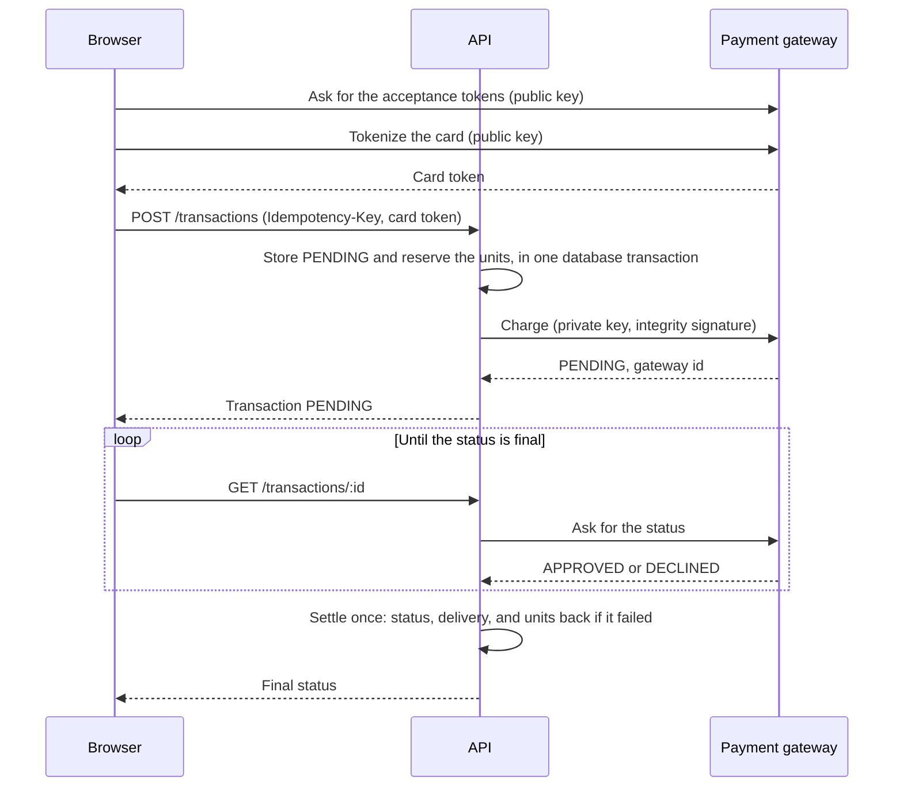

# Payment flow in detail

What happens between the click on "Pay" and the final status, and what the API does when something on the way fails. The summary is in the [README](../README.md#business-rules).

## Sequence

The card never reaches the API: the browser exchanges it for a token directly with the gateway.

## Two ways to learn the result

The gateway usually answers `PENDING` first. The final status then arrives in one of two ways, and whichever comes first settles the purchase; the other changes nothing.

- **Asking.** While a transaction is `PENDING`, `GET /transactions/:id` asks the gateway again. The browser calls it every few seconds.
- **Being told.** The gateway can call `POST /webhooks/payment-gateway`. The event is accepted only if its checksum matches, compared in constant time; a wrong signature gets `401`.

## When the answer to the charge is lost

A timeout or a restart can leave a purchase `PENDING` without a gateway id. It is then looked up in the gateway by its reference:

- If the gateway knows it, its status is applied.
- If two minutes later the gateway still does not know it, the charge never arrived: the purchase ends as `ERROR` and its units are released.

## When the gateway is down

A circuit breaker stands between the API and the gateway. After 5 timeouts or `5xx` answers in a row the gateway is not called for 30 seconds, and then a single trial call decides whether to resume. A purchase made in that window ends as `ERROR` at once, because nothing was sent and nothing was charged.

## Timeouts

| Call | Limit |
|---|---|
| API to the gateway | 10 seconds (`GATEWAY_TIMEOUT_MS`) |
| Browser to the API or the gateway | 15 seconds, then the request is cancelled |
| A request waiting for a database connection | 5 seconds |
| A database statement | 10 seconds |

## What the browser does with an unknown outcome

- If a payment is sent and no answer comes back, the status screen says it is still being confirmed and offers only to check again. It does not offer a new purchase, which could end in a second charge.
- "Try again" sends the same purchase with the same `Idempotency-Key`, so a retry can never charge twice.
- If the API does not know a payment the browser remembers, it is looked for a few more times, because the request to pay may still be on its way. Only then the app says the card was not charged.
